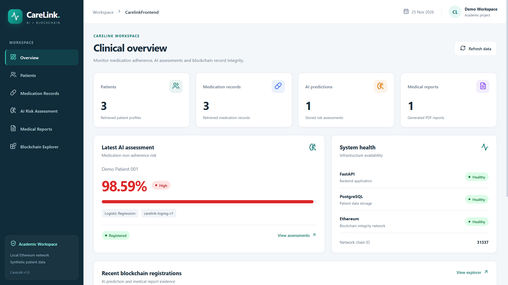
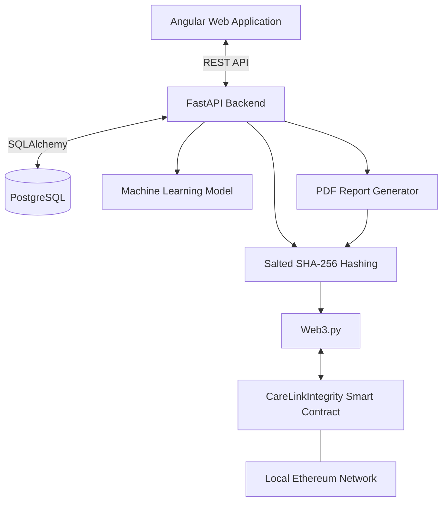
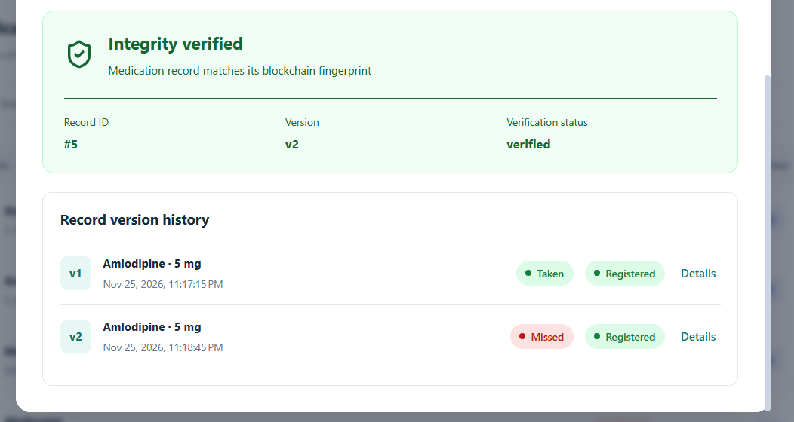
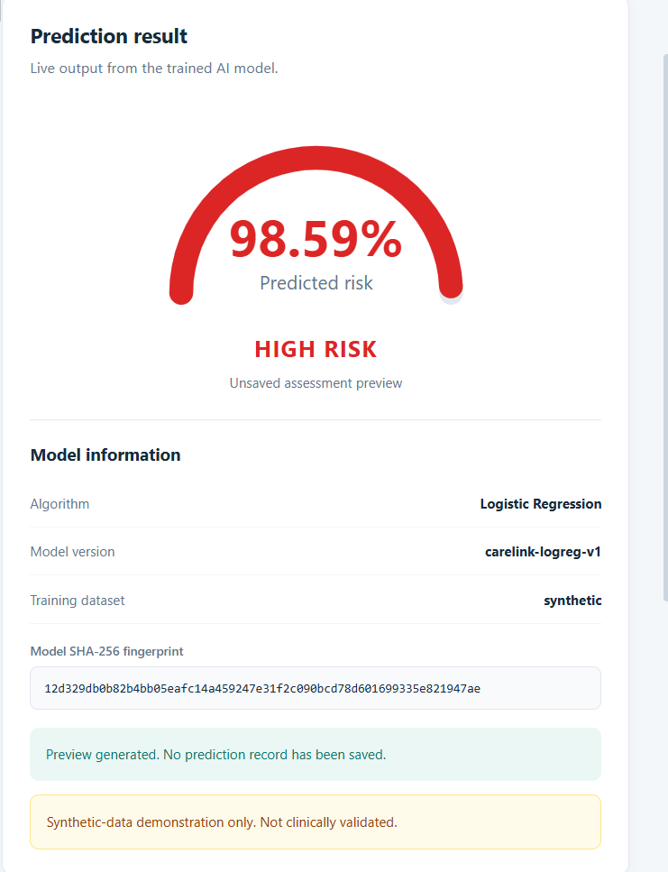
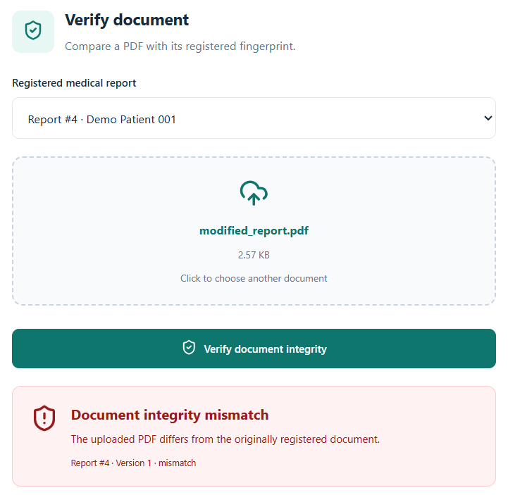
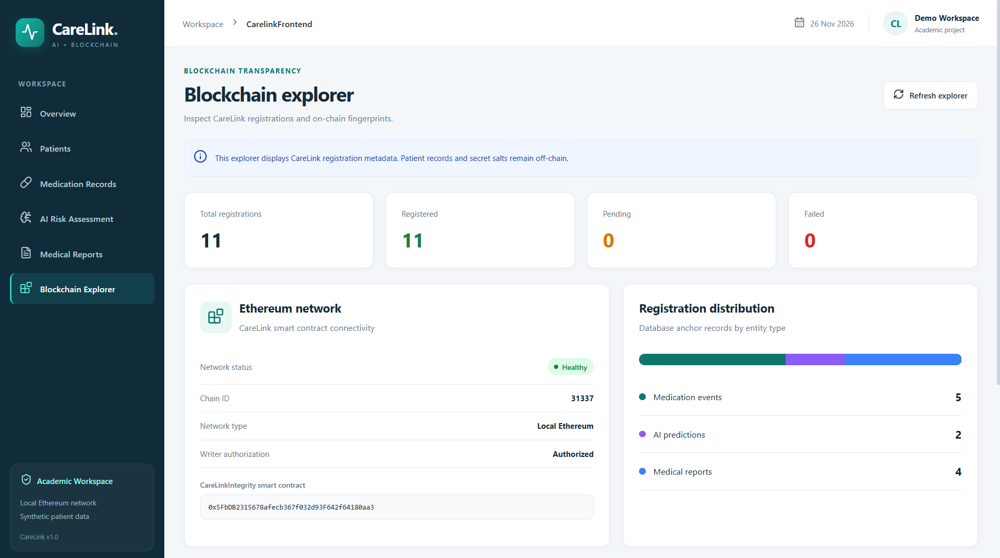

# CareLink Blockchain

### AI-Based Medication Adherence Prediction and Blockchain-Powered Medical Record Integrity Verification


## Project Overview

CareLink Blockchain is a full-stack academic healthcare application that combines machine learning, blockchain technology and cryptographic hashing to demonstrate medication adherence prediction and medical record integrity verification.

The system stores medical information off-chain in PostgreSQL while registering salted SHA-256 fingerprints on an Ethereum smart contract. This enables subsequent integrity verification without publishing raw medical information on the blockchain.

Developed as a semester project for Introduction to Cryptography and Blockchain at Riphah International University.

## Application Preview



## Key Features

- Patient registration and management.
- Medication adherence event recording.
- Version-controlled medication record corrections.
- AI-powered medication non-adherence risk estimation.
- Blockchain registration of medication and AI prediction fingerprints.
- Medical PDF report generation and download.
- Uploaded PDF integrity verification.
- Detection of unauthorized record modifications.
- Searchable blockchain registration ledger.
- Transaction hashes, block numbers and smart contract evidence.
- Blockchain registration retry mechanisms.
- Local development blockchain recovery utility.

## System Architecture



## Technology Stack

| Layer | Technology |
|---|---|
| Frontend | Angular 21, TypeScript, SCSS |
| Backend | Python, FastAPI |
| Database | PostgreSQL 17 |
| ORM and migrations | SQLAlchemy, Alembic |
| Machine learning | Scikit-learn, Logistic Regression |
| Cryptography | Salted SHA-256 |
| Smart contracts | Solidity |
| Blockchain development | Hardhat, Ethereum |
| Blockchain integration | Web3.py |
| PDF generation | ReportLab |
| Testing | Pytest, Solidity tests, Vitest |
| Version control | Git and GitHub |

## How Integrity Verification Works

1. A medication event, AI prediction or medical report is created.
2. The original information is stored off-chain.
3. A random record reference and secret salt are generated.
4. A SHA-256 fingerprint is calculated using the appropriate serialization or PDF hashing procedure.
5. The fingerprint, record reference and version are registered on the smart contract.
6. Transaction metadata is recorded in PostgreSQL.
7. During verification, the fingerprint is recalculated and compared against the blockchain registration.

A matching fingerprint confirms consistency with the registered content. A mismatch indicates that the submitted content differs from the registered version.

### Version-Controlled Corrections

Legitimate medication record corrections create a new version rather than replacing the original blockchain registration. Earlier versions remain available for historical verification.



## Artificial Intelligence

The application uses a Logistic Regression model trained on synthetic medication adherence data.

Input features include:

- Patient age.
- Daily scheduled doses.
- Recently missed doses.
- Medication adherence rate.
- Reminder response rate.
- Medication count.
- Chronic condition count.
- Previous non-adherence history.

The model estimates non-adherence risk and classifies it as Low, Medium or High.



The model is intended for academic demonstration and has not been clinically validated.

## Medical Report Verification

Medical reports can be generated from saved AI predictions and downloaded as PDF documents.

The application registers a fingerprint of the exact PDF bytes. Uploading a modified PDF produces a different fingerprint, allowing unauthorized changes to be detected.



## Blockchain Explorer

The blockchain explorer provides a centralized view of CareLink registration metadata, including record references, fingerprints, versions, transaction hashes, block numbers and registration statuses.



Explorer verification compares the stored fingerprint against the smart contract. Verification of the underlying medical content is performed separately through its corresponding application module.

## Repository Structure

```text
CareLink-Blockchain/
├── backend/
│   ├── app/
│   ├── migrations/
│   ├── ml/
│   ├── tests/
│   └── requirements.txt
├── blockchain/
│   ├── abi/
│   ├── contracts/
│   ├── ignition/
│   ├── services/
│   └── python_tests/
├── frontend/
│   └── src/
├── scripts/
│   └── restore_demo_blockchain.py
├── docs/
│   └── screenshots/
├── alembic.ini
└── README.md
```

## Local Installation

### Prerequisites

- Python 3.11
- Node.js 24 and npm
- PostgreSQL 17
- Git

### 1. Clone the Repository

```powershell
git clone https://github.com/SaifMajidKhan/CareLink-Blockchain.git
cd CareLink-Blockchain
```

### 2. Configure the Python Environment

```powershell
python -m venv .venv
.\.venv\Scripts\Activate.ps1
python -m pip install -r backend/requirements.txt
```

### 3. Configure PostgreSQL

Create a dedicated PostgreSQL database named `carelink_blockchain`.

```powershell
psql -U postgres -c "CREATE DATABASE carelink_blockchain;"
```

Create the backend environment file:

```powershell
Copy-Item backend/.env.example backend/.env
```

Update the database credentials in `backend/.env`, then apply migrations:

```powershell
python -m alembic upgrade head
```

### 4. Prepare the Machine Learning Model

From the repository root:

```powershell
python -m backend.ml.generate_dataset
python -m backend.ml.train_model
```

### 5. Start the Local Ethereum Network

In a separate terminal:

```powershell
cd blockchain
npm ci
npx hardhat node
```

Keep the blockchain terminal running.

In another terminal, deploy the contract:

```powershell
cd blockchain
npx hardhat ignition deploy ignition/modules/CareLinkIntegrity.ts --network localhost
```

From the repository root, create the blockchain configuration file:

```powershell
Copy-Item blockchain/.env.example blockchain/.env
```

Configure the RPC URL, chain ID, deployed contract address and authorized local writer address.

For the local Hardhat unlocked account, the private key field can remain empty.

### 6. Start the Backend

From the repository root with the Python virtual environment activated:

```powershell
python -m uvicorn backend.app.main:app --reload --port 8000
```

### 7. Start the Frontend

In another terminal:

```powershell
cd frontend
npm ci
npm start -- --port 4200
```

### Application URLs

| Service | URL |
|---|---|
| Angular application | http://localhost:4200 |
| FastAPI backend | http://127.0.0.1:8000 |
| Swagger API documentation | http://127.0.0.1:8000/docs |
| Local Ethereum RPC | http://127.0.0.1:8545 |

## Local Blockchain Recovery

The Hardhat development network uses temporary blockchain state. Restarting the node may remove previously registered fingerprints even though PostgreSQL retains its records.

After redeploying the contract to the original configured address, preview the recovery:

```powershell
python -m scripts.restore_demo_blockchain
```

If the preview succeeds, restore the demo registrations:

```powershell
python -m scripts.restore_demo_blockchain --apply
```

This utility re-registers stored fingerprints and reconciles transaction metadata. It does not recover the original blockchain history and must only be used for the local academic demonstration.

## Automated Testing

Run the Python test suite from the repository root:

```powershell
python -m pytest -q
```

Run smart contract tests:

```powershell
cd blockchain
npx hardhat test
```

Run frontend tests and production compilation:

```powershell
cd frontend
npm test -- --watch=false
npm run build
```

Run each directory-specific command from the repository root.

## Security and Privacy Considerations

- Raw medical information remains off-chain.
- Secret salts are not exposed through the blockchain explorer.
- Smart contract registration requires an authorized writer.
- Record versions cannot be overwritten through the smart contract.
- Environment credentials are excluded from version control.
- Synthetic data is used for academic demonstrations.

## Project Limitations

- The application uses a local Ethereum development network rather than a production decentralized deployment.
- The machine learning model is trained on synthetic data and is not clinically validated.
- Authentication and production-grade role-based access control are outside the current project scope.
- Blockchain verification establishes consistency with registered content, not the medical accuracy of the original information.
- The system cannot independently prove that a patient consumed a medication.
- Local blockchain recovery creates new transaction evidence rather than restoring historical transactions.
- Production deployment would require additional privacy, security and regulatory safeguards.

## Future Enhancements

- Integration with the main CareLink healthcare platform.
- Persistent or consortium blockchain deployment.
- Patient and caregiver authentication.
- Role-based access control.
- Clinically validated adherence prediction models.
- Automated notifications and care coordination.

## Academic Purpose

This project demonstrates the practical integration of cryptographic hashing, smart contracts, blockchain-based integrity verification, machine learning and modern full-stack application development.

It is an educational prototype and is not intended for clinical decision-making.